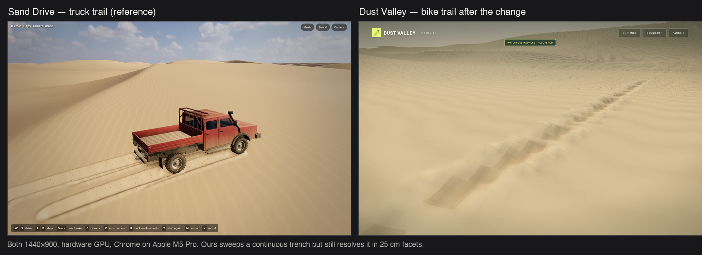
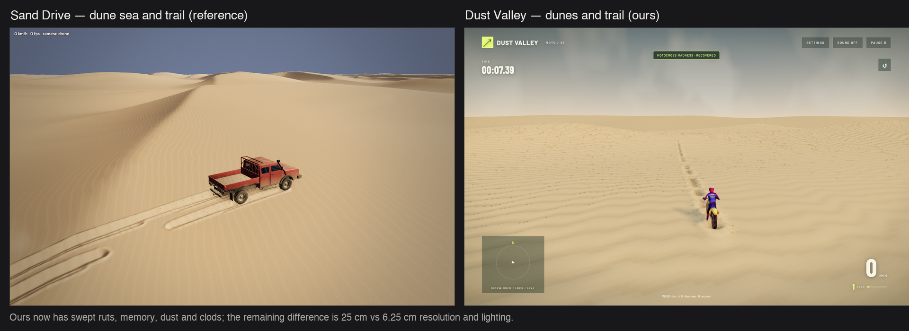

# Sand Drive vs Dust Valley: deformable sand and sand-adjacent "stuff"

**Compared:** <https://sand-drive.imaginestudio.fun/> (bundle `assets/index-BOGQYm3s.js`, 507,708 bytes) against this repository at `42d4353` ("Draw the fine sand field so wheel ruts are visible").
**Captured:** 2026-11-20, Chrome 157.0.8103.79, Apple M5 Pro / 24 GB, 1440×900, hardware WebGL2 backend, high quality, 60 fps. Both were also exercised through their debug handles (`window.__drive` and `window.__game`).
**Method:** the reference is a production bundle, so its shaders and update passes were read from the minified/beautified source; no reference code was copied. Runtime comparisons use the reference's public sand API (`readTracks`, `readMemory`, `window`) and our `__game.sandSample`, `__game.environment`, renderer statistics and screenshots. Numbers below are measured on this one machine; they are not a mobile benchmark.

> **Post-comparison implementation (2026-11-20).** The four Sprint 1/2 items from this report are now implemented and shipped: swept `SWEEP`/`RINGSWEEP` contacts, the enabled and tuned `SandFx` spray/clods, depth-based AO plus trough/berm tinting, the 25 cm persistent memory map, and one sand truth. The GPU fine field is now `state.physics.sand`; the recovered terrain samples it through `displacementAt()`, the CPU mirror is readback-only, `recover()` recenters it, and the dead Cannon heightfields and package are gone. The coarse field's `observe()`/`readAround()` are wired. The scorecard below has been updated to the current state; the analysis sections that describe the pre-change gaps are retained because they explain why the implementation looks the way it does. The remaining honest gap is resolution: 25 cm cells still facet a 30–40 cm trench, where the reference runs 6.25 cm cells and an 8 cm LOD mesh.

## TL;DR

The reference is a **sand-first visual system**. It puts a 48 m live field at 6.25 cm on a 1,024 m persistent memory map, simulates it at 120 Hz with 8-neighbour granular flow, carves it with swept wheel segments, and renders a 10-ring LOD sand mesh with cubic filtering, curvature AO, crest shadows, glints, sheen, 6,000 spray grains and 768 dust billboards. Its truck does **not** drive on the deformed height; the deformation is how the sand looks and how the truck sinks visually.

Ours is a **physics-first system**. A 900 m avalanche field at 0.88 m and 30 Hz plus a 128 m fine field at 25 cm and 60 Hz produce ruts, and the CPU copy of those ruts is sampled by the recovered Motocross Madness terrain, so the bike really rides the trenches it makes. After the implementation below, that CPU copy is readback-only: the GPU fine field is the single surface, a 512 m memory map keeps old trails, swept contacts cut continuous trenches, and the spray/clod system is live.

Visually the reference is clearly ahead on trail quality, persistence, granularity and light. Ours is ahead on physical coupling, simulation ambition and renderer portability. The gap is closeable; most of it is in four places: **contact-tool shape**, **near-field resolution**, **persistent memory**, and **shading/VFX wiring**.



## Scorecard

| | Sand Drive (reference) | Dust Valley (ours) |
|---|---|---|
| Live sand field | 48 m, 768², **6.25 cm** cells | 128 m, 512², **25 cm** cells |
| Far-field | 1,024 m memory map, 4,096² @ **25 cm** | 512 m memory map, 2,048² @ **25 cm** (`sand-memory-gpu.js`) |
| Avalanche field | 8-neighbour axial + diagonal flux, 120 Hz, dynamic box, up to 10 contact substeps | 4-neighbour BCRE flux, 900 m at 0.879 m, 30 Hz, whole field |
| Wheel–sand tool | swept **line segment** per wheel, flat/round, pressure, packing, shell, yield | swept **capsule** dig + swept side berm (`SWEEP`/`RINGSWEEP`), 25 cm lattice |
| Resting angles | tan 0.65 (33.0°) static, tan 0.52 (27.5°) flowing | 34° static, 31° dynamic (fine field slump at 31°) |
| Physics coupling | **none** — vehicle rides the base dune height | **yes** — the GPU fine field is the MCM terrain surface |
| Visual truth | one continuous system: live + memory | one field: GPU fine field, read back to a CPU mirror for physics |
| Render LOD | 10 concentric rings, 8 cm near → 5.2 km, edge morph | 25 cm fine mesh → 2.5 m coarse mesh → horizon mesh, fade at 128 m |
| Sand shading | cubic B-spline sampling, curvature AO, crest-shadow march, AA ripples, grain, glints, sheen | bilinear sampling, neighbour normals, ripples, glints, depth AO + trough tint; no crest march |
| Particles | 6,000 spray grains + 768 dust billboards | `SandFx` enabled and tuned: dynamic dust + ballistic clods, plus the generic puff layer |
| Measured rut | −0.120 m / +0.120 m, continuous trench | continuous swept trench, −0.05 to −0.09 m, still 25 cm-faceted |
| Frame rate | 60 fps (27 fps under SwiftShader) | 60 fps |
| Renderer | WebGL2 + float render targets only | WebGPU/TSL with WebGL2 fallback |
| Frame cost | scissored passes over the active box | full-field passes + 96² readback every 3rd frame + memory writes; 3.13 M triangles, ~120 draws, ~330 MB textures, 27 render targets |
| Tests | none visible | 10 passing sand tests, including swept contact and terrain-sampling tests; GPU shaders still lack a headless test |

## What the reference actually does

The bundle is a self-contained WebGL2 sand runtime. Its shaders are the clearest specification:

- **Simulation state**, 768² RGBA float: `R` sand height *above* the static dune field, `G` activity, `B` disturbed, `A` dirty (needs memory write).
- **A static dune map**, 1,024² at 1 m, generated from warped FBM with a slope limiter (`maxSlope 0.58`), `duneHeight 12`, `duneLength 110`, plus small dunes and a 9 m swell. This is never eroded; the live field only stores the deviation.
- **Contact textures**, 768² RGBA float ×2, written from up to **16 line-segment tools** per frame. Each tool carries: from→to, radius, pressure, underside depth at both ends, velocity, flat (rolling wheel) vs round, packing, spray and dust multipliers. The shader produces coverage, loose shell, motion, target depth, pressure, rolling/packing flags and a radial `where` used to push sand outward.
- **Flux pass** into two RGBA targets: 4 axial + 4 diagonal outflows. Rolling wheels push sand sideways (not ahead); shoving tools bulldoze it; a tool's evacuation spills up to 86 % of the push it could not slide, and a lightly packing rolling wheel up to 92 %. Flow is limited to half the drop to the lowest neighbour, with a supercritical boost. Still sand only fails above 33°; flowing sand behaves as if at 27.5°.
- **Transport/update pass**: incoming minus outgoing, packing compresses loose sand under a wheel (it goes down without going anywhere), activity decays, disturbed is sticky, dirty flags a memory write.
- **Memory**: a 4,096² wrap-around map at 25 cm covering 1,024 m. Every 0.3 s the live window is written into it with a two-texel tent filter (and depth restored because the memory texel is wider than the groove). When the window moves, new cells load from memory. That is why ruts persist after you leave the 48 m window.
- **Render**: a single mesh of 10 concentric 256² rings with a 0.08 m inner spacing doubling per ring, morphed at the edges. Vertex shader = dune height + cubic-filtered live/memory offset + ripple gradient. Fragment shader adds curvature AO (`laplacian * 0.012`), a 22-step sun march for crest shadows, anti-aliased 0.45 m ripples with a second 0.37× layer, sub-pixel grain, 1.8 cm glint cells and a sheen term.
- **VFX**: 6,000 instanced spray grains (small and larger clods) plus 768 dust billboards, emitted per contact from wheel speed, slope splash and crashes. The truck also loses doors/parts on hard impacts.
- **Vehicle**: a custom 240 Hz raycast-wheel model with four wheels and hull probes, tuned by surface coefficients (`grip`, `slide`, `sink`, `roll`, `dig`, `plough`). Its `heightAt` returns the **dune field only**; it never reads the deformed height back. The truck visually sinks into the sand by a fixed wheel sink, and its trail tools paint the ruts you see.
- **Quality**: `high` uses 768²/4,096²/256²/10 levels; `performance` uses 512²/2,048²/160²/10 levels. Float linear filtering selects cubic sampling and smooth ripples; without a float colour buffer it disables live sand and says so.

A useful mental model: the reference is a very good **decal system for a vehicle on dunes**, with the decals themselves being a shallow granular simulation. It is not a terrain-mutation simulation that feeds back into driving.

## What ours actually does

Our sand is now one field with a CPU mirror, plus a dune-scale field and a persistent record:

- **Fine field (truth)** — [`sand-fine-gpu.js`](../src/sand-fine-gpu.js): 512² over 128 m (25 cm), 60 Hz, toroidal window. Channels are detail, compaction, disturbance, exact-terrain residual. Ops: dig, swept wheel capsule (`SWEEP`), swept side berm (`RINGSWEEP`), deposit. A 4-neighbour anti-symmetric slump at 31°, plus saltation/creep ripples at 1.25 m.
- **Physics view** — [`sand-gpu-surface.js`](../src/sand-gpu-surface.js): a 96² CPU mirror read back from the fine field every 3rd frame, with an immediate predictor and op replay. The recovered MCM terrain samples it through [`mcm-sand-terrain.js`](../src/mcm-sand-terrain.js) and `displacementAt()`. There is no Cannon body: the old 16 m and 3×16 m heightfields are gone.
- **Persistent memory** — [`sand-memory-gpu.js`](../src/sand-memory-gpu.js): 2,048² at 25 cm over 512 m, RGBA float (detail, compaction, disturbance, valid). It is written from the live window every 8 steps and before the window moves; entering nodes are seeded from it; the coarse terrain samples it for a distant rut tint.
- **Coarse avalanche field** — [`sand-flow-gpu.js`](../src/sand-flow-gpu.js): 1,024² over 900 m (0.879 m), 30 Hz, 4-neighbour BCRE with a rolling layer, Pouliquen's `h_stop`, 34°/31°, bedrock and a flowing flag. Rider changes flow in through `observe()`, and avalanche offsets return through `readAround()` every sixth frame; `heightAt()` mixes the offsets back into the physics surface.
- **Render** — [`sand-fine-render.js`](../src/sand-fine-render.js): 512² vertices at 25 cm, per-vertex normals, depth AO and a trough/berm albedo tint. [`textures.js`](../src/textures.js) draws the far terrain, flow displacement, painted ripples and a memory tint. The coarse mesh is 360² at 2.5 m; a horizon mesh extends beyond 900 m.
- **Particles** — [`sand-fx.js`](../src/sand-fx.js) is enabled and tuned: dynamic dust from both tires plus ballistic clods that deposit their sand where they land. The generic `puff()` layer remains for minor dust.

The architectural change is that **the GPU fine field is now the single truth**. `activeSand` and `state.physics.sand` point at the same `GpuSandSurface`; the CPU surface is a readback mirror, not a second stamping model. `recover()` reuses that field and recenters it; `start()` disposes the previous fields before creating new ones. The coarse avalanche field is wired into the same surface instead of being a visual side channel.



## Measurements

### Resolution and coverage

| | Reference | Ours |
|---|---:|---:|
| Live cells | 589,824 (768²) | 262,144 (512²) |
| Live cell size | 0.0625 m | 0.25 m |
| Live coverage | 48 m | 128 m |
| Avalanche/coarse coverage | included in live + memory | 900 m at 0.879 m |
| Persistent coverage | 1,024 m at 0.25 m | 512 m at 0.25 m |
| Render vertex spacing | 0.08 m inner ring, doubling ×10 | 0.25 m fine / 2.5 m coarse |

The reference has **16× the cell density per square metre** in the area that matters, and **4× smaller cells** than our fine field. Our larger 128 m window is the trade: we keep detail farther out, but every visible rut is made of 25 cm facets. That is the single biggest reason the two trails look different.

### Dynamics

| | Reference | Ours |
|---|---:|---:|
| Live step | 120 Hz (1–4 whole-box substeps; up to 10 in the contact box) | 60 Hz fine, 30 Hz coarse |
| Flow neighbourhood | 8 | 4 |
| Static / dynamic repose | 33.0° / 27.5° | 34° / 31° (fine slump 31°) |
| Max dig | 0.32 m | 0.34 m profile limit, but typical bike sink ≈ 0.05 m |
| Tool count | 16 segments | 24 ops per pass |
| Readback | none for physics; synchronous `readTracks`/`readMemory` helpers | 96² window at 20 Hz, CPU predictor + replay |
| Injection | tools write the state directly, every frame | `observe()` never called |

Our extra substeps in the contact box are not present; the reference effectively supersamples the wheel area, which is why its ruts keep a clean cross-section at speed. Our `deform()` bridges contact points at 0.125 m with discrete discs, which is the right idea but not the same as a swept capsule.

### Runtime numbers

- **Rut depth:** reference truck `readTracks` near the contact box: −0.120 m to +0.120 m at 6.25 cm. Ours on a 61 km/h bike run: a continuous swept trench around −0.05 to −0.09 m, still made of 25 cm facets; a readback of the memory map confirms the same values persist after leaving and returning to the window.
- **Visual vs physics height:** after the single-truth change, runtime checks return identical values for `environment().height` (physics) and `visualHeight` (GPU). Before the change the same check measured up to **4.1 cm** of divergence, which is what motivated the refactor.
- **Render cost:** 3,129,182 triangles, 116 draw calls, 264 MB of textures, 26 render targets, 60 fps at 1440×900. The reference also held 60 fps but exposes no renderer stats; its design is scissored to the active box and its ring mesh is roughly 1.3 M triangles before culling.
- **Test coverage:** 10/10 sand tests pass, including swept-contact continuity (`SandSurface` and `GpuSandSurface`) and the `displacementAt()` terrain sampling. There is still **no headless test** for the GPU shader ops, the fine-field readback, or the memory-map render pass.

## Where the gap actually comes from

### 1. Contact shape: discs vs swept segments (biggest visual cause)

The reference's wheel tool is one segment `from → to` per wheel per frame, with depth interpolated along it. At 16.7 m/s and 60 fps, one tool covers 0.28 m; at 6.25 cm cells that is 4–5 cells of a continuous capsule. Our `stamp()` loops from the previous contact to the current one and emits **discrete dig discs** every 0.125 m. On a 25 cm lattice, only one or two vertices see the full depth, and the neighbours see almost none, so the trench becomes a chain of pits with ridges between them. Slumping eventually softens it, but not before you see it.

Fix: add a `SWEEP` op to [`sand-fine-gpu.js`](../src/sand-fine-gpu.js) with `from`, `to`, `radius`, `depthFrom`, `depthTo`, `compaction`, and compute distance to the segment in the shader exactly like the reference's contact pass. Emit **one** op per wheel per physics step, and use it for both the GPU field and the CPU predictor. That alone will remove most of the scalloping.

### 2. Resolution: 25 cm cannot hold a 30 cm trench

A motorcycle rut is 20–40 cm wide and 5–15 cm deep. At 25 cm cells it is one cell wide. The reference resolves it with 6.25 cm cells and 8 cm vertices. Options, in ascending cost:

1. Keep the 128 m window but add a **second inner window** (e.g. 48–64 m at 6.25–12.5 cm) that is the only one that renders ruts; the 25 cm field becomes the transition/LOD.
2. Move to 512² over 64 m (12.5 cm) and keep a 25 cm memory/render ring for 64–256 m.
3. Match the reference: 768² over 48 m at 6.25 cm plus memory. This is 4× our current fine cost, so it needs the dirty-box/scissor discipline the reference uses.

The physics readback can stay at 25 cm; visual resolution and collision resolution do not have to be identical if the CPU predictor is good. But the *visible* surface should not be the coarser one.

### 3. Persistence: ruts vanish when the window moves

This is the most obvious immersion failure. Our fine window is toroidal: when a node scrolls out, its state is gone. When it scrolls back, it is reseeded from `trackTexture`, which is 1×1 black, and `trackMap` is never updated. The CPU `SandSurface` keeps up to 128 soil tiles (~181 m square) and does remember physics ruts longer than the visual field, but it too evicts and it is not what you see.

The reference's memory map is relatively simple and high-value:

- 2,048² or 4,096² half-float RG (height + disturbed) covering 512–1,024 m at 25 cm.
- On window movement, load new cells from memory; every 0.3 s, write the live window into memory with a tent filter.
- In the sand shader, sample memory outside the live window with cubic B-spline filtering and fade it into the live field with a world-space weight.
- Feed the same memory into the coarse terrain material (replacing the stub `trackMap`) so distant ruts still tilt normals and darken the ground.

This is maybe 150 lines of shader + 80 lines of JS, and it fixes the "my tracks disappeared" problem completely.

### 4. Wiring and truth: four dead integrations

These are not subjective polish; they are code paths that look implemented but never run:

| Path | Intended effect | Actual |
|---|---|---|
| `SandFlowGPU.observe()` | rider soil changes enter the coarse avalanche field | never called; `pending` stays empty |
| `SandFlowGPU.readAround()` | avalanche offsets feed the 25 cm collision patch | never called; `offsets` all zero |
| `trackTexture` / `soilUniforms.trackMap` | persistent ruts + far-rut shading | 1×1 stub, never written |
| `SandFx.update()` / `root.visible` | dust, roost and clods | `root.visible=false` every frame; `update` never called |

And two structural mismatches:

- **CPU vs GPU sand:** the CPU `SandSurface` determines handling, the GPU `FineSandGPU` determines looks. They are close but not equal; the measured 2–4 cm divergence is enough to see. Pick one source of truth. The cleanest route is to keep the GPU fine field as truth and make the CPU surface a readback mirror (the existing `applyReadback` + predictor), deleting the duplicate `stamp()` path. Or keep the CPU field and upload it to the GPU each step; that is simpler to reason about but costs a 25 cm upload.
- **`recover()`** must re-center both fields and restore `activeSand` to the GPU surface; today it falls back to the CPU surface while the GPU mesh stays behind.

Removing the dead Cannon path is also worthwhile: both `SandSurface.follow()` and `GpuSandSurface.follow()` build 65² heightfields every 16 m, but `tileWorld.addBody` does nothing. The recovered MCM solver reads the CPU sand deltas directly, so these bodies are pure allocation and update cost. Delete them or make them real.

### 5. Shading: the ruts are there, but the light does not describe them

Even a 5 cm trench should read at a 13° sun. Ours is visible only as a faint normal perturbation. The reference gets its trench contrast from four compounding effects:

1. **Curvature AO** from the Laplacian of the height field (`sandAO = 1 - clamp(lap*0.012, 0, 0.35)`), applied to indirect light.
2. **Track normals** computed from the height field with a pixel-size-aware finite difference and a fade (`trackFade`) so the rut does not shimmer.
3. **Crest shadows** marched toward the sun; our fine mesh relies on CSM shadows, which do not resolve a 5 cm lip.
4. **Granular VFX**: clods and spray along the berm, plus a slightly paler disturbed albedo.

Our fine material has the normals and a compaction/disturbance colour term, but no AO and no crest march. Adding the Laplacian AO and a dark-trough/pale-berm albedo term is cheap and will do more for rut readability than another metre of simulation. The coarse material already has a field normal and ripple shading; the fine material should get the same treatment.

### 6. Particles: the most visible missing "stuff"

The reference's trails are alive: grains and clods kicked backward, dust rolling off the crests, a puff on every hard landing, debris on a crash. Ours has `SandSpray` with dust, clods, roost, ballistic deposition and wind drift — and it is switched off. The fix is small:

```js
// main.js, in the update loop:
const vx = Math.sin(state.yaw) * state.speed, vz = Math.cos(state.yaw) * state.speed;
sandFx.root.visible = phase === 'playing' || phase === 'paused';
if (phase === 'playing') sandFx.update(dt, {
  soil: wild?.soil,
  contacts: state.wheelContacts,
  velocity: { x: vx, y: state.vy, z: vz },
  throttle: state.throttle,
  events: activeSand?.events ?? [],
  height: surfaceHeight,
  deposit: (x, z, v) => activeSand?.deposit?.(x, z, v)
}, camera, sunDir);
```

The existing `SandSpray` already models clods landing and depositing volume; wire it to `activeSand` and remove the unconditional hide. This is the highest visual return per line of the whole comparison.

### 7. Presentation (the first five seconds)

The reference opens on a dune crest with a long view, a blue HDR sky, warm low sun and a drone framing the truck. Ours opens on a flat pan (`dunesHeight` blends to `pan` inside r ≈ 22 m), with a 2.45–3.35 m chase camera looking along the flat, a hazy grey sky and a visible speckle from the soil grain. It makes the sand look flatter than it is.

Cheap wins:

- Move the dunes spawn to the first crest outside the flat pan, facing along the wind.
- Default to a higher/farther camera (or a drone preset) with a longer look-ahead on first load.
- Raise the sky's blue/cloud contrast, reduce near haze, and check the wild-view `zenith`/`horizon`/`clouds` actually reach the sky material (they do in `applyTime`, but the screenshots still read overcast at 13° elevation).
- The reference uses a 2k HDR environment; a small HDR or a better procedural sky with a warm bounce would close much of the "flat" impression.

### 8. Performance and lifecycle

Both hold 60 fps at 1440×900 on an M5 Pro, so this is not an emergency. Still:

- Our sand cost is **full-field**: 1,024² flux/update at 30 Hz and 512² fine at 60 Hz, plus a 96² readback every third frame. The reference scissors the sim to the box touched by tools/recent changes. If we add a 6.25 cm field, we must add the scissor/dirty-box discipline or the cost will not fit mobile.
- Add sand quality tiers (`size`, readback window, ripple update) to `applyQuality`; today `quality` changes pixel ratio/shadows/vegetation but not the sand.
- `SandFlowGPU` and `FineSandGPU` have no `dispose()`. `start()` calls `setupGpuSand()` again and creates new render targets; `home()` only disables. A few restarts leak a lot of float targets and a new fine mesh. Add disposal, remove the old mesh, and cancel in-flight readbacks.
- Remove or wire the dead integrations above. Dead paths are worse than missing features because they make the README and the code disagree.

## What we should keep

- **Real two-way coupling.** The reference's truck never feels its own ruts. Our MCM terrain sampler does. That is the harder and more interesting half of the problem; do not trade it away for a visual-only sand.
- **Bekker/Wong + Brixius terramechanics, slip sinkage, mass-aware deposits.** The reference has a tuned surface preset; ours has a model with names and units. Keep it, then exaggerate the visual result if needed.
- **WebGPU/TSL with a WebGL2 fallback.** The reference is WebGL2-only. Our renderer is the better long-term base.
- **Modular simulation + CPU reference + tests.** The reference is a 507 KB minified monolith with no tests. Our `sand-flow-model.js` CPU reference and `tests/sand-*.test.js` are a real asset.
- **The rest of the game**: recovered bike/rider, art styles, photo mode, cameras, mobile controls, audio, time presets. The reference is one truck and one dune field; we have a game around the sand.

## Suggested order of work

**Sprint 1 — make the trail look right (highest value, lowest risk)**

1. Swept `SWEEP` contact op (GPU + CPU predictor), one per wheel per step. Removes the pit chain.
2. Enable `SandFx`, wire it to contacts/events/deposit, and make roost/clods land in the sand.
3. Add Laplacian AO + trough/berm albedo contrast to the fine sand; add the same to the coarse material via memory.
4. Fix `recover()` (`activeSand`, `fineSand.center`, `gpuSand.follow`, particle clear).
5. Re-tune spawn/camera/sky for the first five seconds.

**Sprint 2 — persistence and one truth**

6. Memory map at 25 cm over 512–1,024 m, loaded/written around the window, sampled by the sand and coarse shaders; replace `trackMap`/`trackTexture` stubs.
7. Make one field authoritative. Either read the GPU field back for the MCM terrain (delete the duplicate CPU stamping) or upload the CPU field to the GPU. Keep the 25 cm collision readback if physics needs it.
8. Wire or delete `observe()`/`readAround()`. If we keep the avalanche field, feed its offsets into `GpuSandSurface` and the fine renderer.
9. Delete the dead Cannon heightfields or put them in a real world.

**Sprint 3 — resolution, quality, polish**

10. Add an inner 6.25–12.5 cm near field (48–64 m) with scissored passes, if Sprint 1–2 leave headroom.
11. Sand quality tiers; mobile budget; dispose/restart lifecycle.
12. Align ripple scales between fine and coarse (today 1.25 m geometry vs 0.45 m/3.1 m shading), and verify the seam at 128 m.
13. Update README claims and stale smoke scripts.

## Reference / code index

- Reference: <https://sand-drive.imaginestudio.fun/> (`assets/index-BOGQYm3s.js`). The relevant code is the `sandSim`/`sandMem` shader block and the `createSand`-style class near the end of the bundle; the vehicle is the `createVehicle` class and uses `heightAt` = dune field only.
- Ours: [`sand-flow-gpu.js`](../src/sand-flow-gpu.js), [`sand-fine-gpu.js`](../src/sand-fine-gpu.js), [`sand-gpu-surface.js`](../src/sand-gpu-surface.js), [`sand-physics.js`](../src/sand-physics.js), [`sand-fine-render.js`](../src/sand-fine-render.js), [`textures.js`](../src/textures.js), [`sand-fx.js`](../src/sand-fx.js), [`mcm-sand-terrain.js`](../src/mcm-sand-terrain.js), [`main.js`](../src/main.js).
- Screenshots: [`sand-drive/`](sand-drive/): `ref-trail.png`, `our-trail.png`, `ref-wide.png`, `our-wide.png`, plus the two composites.

> Caveat: the reference is minified and has no public source, so the pass names above are descriptive, not official. Its update order, window sizes and constants were read from the shader/uniform setup and cross-checked at runtime via `window.__drive`. The reference's WebGL2/float-RT requirement means it silently degrades (no live sand) on hardware without `EXT_color_buffer_float`; that did not apply to the capture machine.
